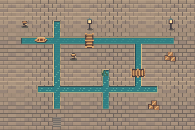

# Canal Works

A 32 x 32 pixel-art kit for building narrow waterways in Tiled. Paint canals through a paved quay, then place a skiff, footbridge or signal lamp on a second layer.

[Download Canal Works 1.0 (ZIP)](https://raw.githubusercontent.com/reachshujath/atlas-ferry-sample/main/canal-works/Canal-Works-1.0.zip)

## Open the sample

1. Extract all five files into one folder and open `sample-quay.tmj` in Tiled. The map loads its tileset and image using relative paths.
2. Select the **Waterways** layer. In the Terrains panel, select **Canal** in **Quay and canal**, then use the Terrain Brush. Paint along tile edges to connect neighboring cells. Select **Quay** to replace a connection with paving.
3. For exact placement, use the Stamp Brush. The first two atlas rows contain all 16 combinations of north, east, south and west connections. The first cell is plain paving.
4. Select **Quayside props** and stamp decorations from the third row. Use the upright footbridge across a horizontal canal, or the sideways footbridge across a vertical one. The bridge artwork is a visual overlay. Define walkability in your own game.

The atlas is 256 x 96 pixels with eight columns, zero spacing and zero margin. For other engines, import the PNG with nearest-neighbor filtering and slice on a 32-pixel grid. The separate sample PNG shows the intended map appearance.

## Use in your project

You may use, modify and include the artwork and map in personal or commercial games, prototypes and teaching materials. Attribution is optional. Version 1.0, November 2026. AI-assisted original artwork and packaging. Independent of the Tiled project.
